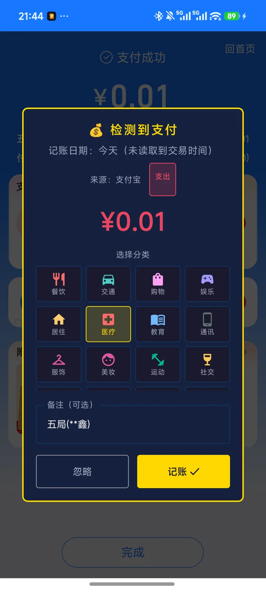
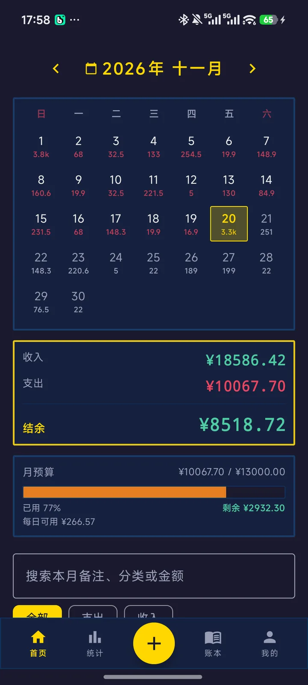
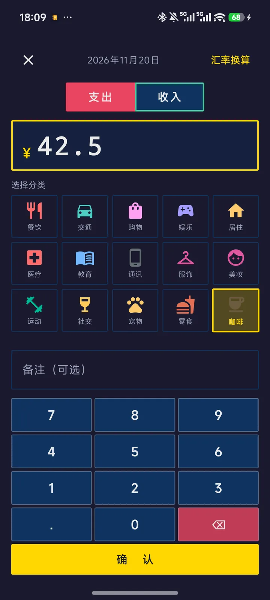
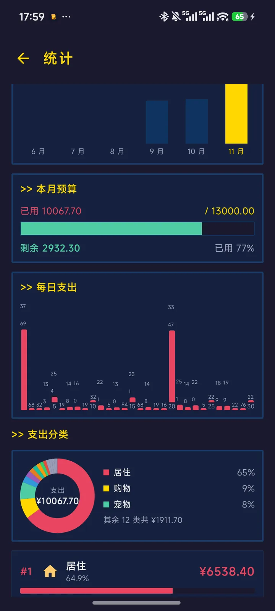
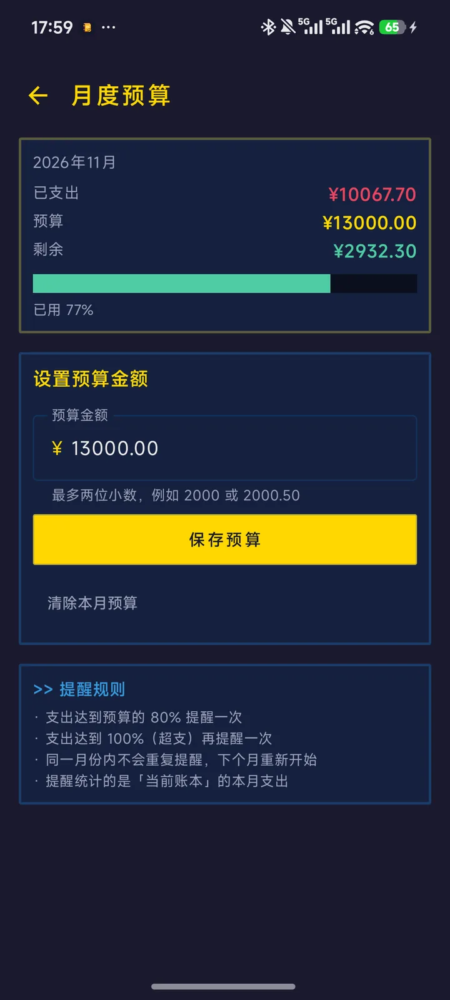
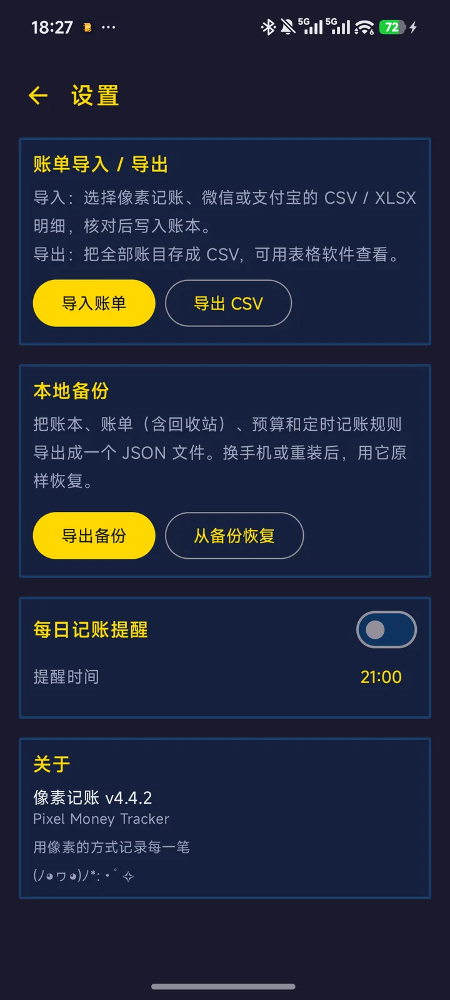

<div align="center">

<h1>像素记账 · PixelMoney</h1>

<p><b>付完款的那一刻，账单页面自己弹出来问你要不要记。</b></p>

<p><sub>Android 自动记账 · Kotlin + Jetpack Compose + Room · 数据只存在本机</sub></p>

<p>
  <a href="https://developer.android.com"></a>
  <a href="https://kotlinlang.org"></a>
  <a href="https://developer.android.com/jetpack/compose"></a>
  <a href="https://github.com/nanzhe-qwq/PixelMoney/releases/latest"></a>
  <a href="LICENSE"></a>
</p>

<p>
  <a href="docs/promo.mp4"></a>
  <br>
  <sub>▶ 31 秒宣传片，点开就能播</sub>
</p>

</div>

---

它想解决的不是「记账能不能更快」，而是**根本不用记得去记账**。微信、支付宝扫码 / 转账 / 收款完成后，在支付成功页或账单详情页上直接浮起一张记账卡：金额、商家、时间已经填好，点一下入账，点忽略就当没发生。淘宝、拼多多、京东外卖、美团、饿了么这些页面也一样——只有真的付完了才提示。

数据全在本机：没有账号、没有云同步、不联网（只有你主动点「获取参考汇率」时才访问一次 ECB）。表结构、迁移、备份格式都在仓库里，随时可以自己审计。

## 下载

| | |
| --- | --- |
| 安装包 | [Releases · latest](https://github.com/nanzhe-qwq/PixelMoney/releases/latest) · 3.4 MB · Android 8.0（API 26）以上 |
| 自己编译 | 见[构建](#构建) |
| 宣传片 | [31 秒 mp4](docs/promo.mp4) · [博客长文](https://qwqovoppp.top/blog/pixel-money-automatic-bookkeeping/) |

装好后要在系统里开两样东西：**账单读取**（无障碍服务）和**后台弹出界面**（澎湃 OS / MIUI 的独立开关——只开「显示悬浮窗」是不会弹的，这点踩过坑）。

## 界面

<table>
<tr>
<td align="center"></td>
<td align="center"></td>
<td align="center"></td>
<td align="center"></td>
</tr>
<tr>
<td align="center"><sub>付完款，卡片自己浮上来</sub></td>
<td align="center"><sub>首页按日分组、可搜索</sub></td>
<td align="center"><sub>记一笔 / 汇率换算</sub></td>
<td align="center"><sub>趋势 · 占比 · 预算</sub></td>
</tr>
<tr>
<td align="center"></td>
<td align="center"></td>
<td align="center"></td>
<td align="center"></td>
</tr>
<tr>
<td align="center"><sub>80% / 100% 各提醒一次</sub></td>
<td align="center"><sub>删除先进回收站，30 天可恢复</sub></td>
<td align="center"><sub>导入导出 · 整库备份 · 每日提醒</sub></td>
<td align="center"><sub>权限一眼看清</sub></td>
</tr>
</table>

## 功能

**自动记账**

- 微信 / 支付宝：扫码、转账、收款完成后，直接在支付页弹卡片，不用退出 App
- 淘宝、拼多多、京东（含外卖）、美团、饿了么：页面必须同时出现「完成状态」和「实付金额」才提示，待付款、物流、优惠提醒不会误记
- 账单详情页：读到「交易时间 / 转账时间」就按原日期入账，不会把三个月前的账单记到今天
- 连续两笔不会互相覆盖：弹出的排队，正在编辑的备注不会被冲掉
- 保存失败保留表单，可以原地重试；数据库确认写成功才关窗

**看账**

- 首页按日分组、关键词搜索、收支筛选、月份切换、当日小计
- 统计：近 6 个月支出趋势、每日支出柱状图、分类占比环形图
- 月度预算：到 80% 提醒一次、超支再提醒一次（同一档不重复打扰）

**整理**

- 多账本（日常开销 / 旅行基金 / 学习投资 …）
- 账单导入：微信、支付宝导出的 CSV / XLSX，支持逐笔改分类、选目标账本、自动跳过已导入的重复项
- 导出 CSV；整库 JSON 备份与恢复（换机原样搬过去，汇率与提醒设置随包走）
- 回收站：删除先进回收站，30 天内可恢复，删除瞬间还有 4 秒撤销条
- 定时记账：每天 / 每周 / 每月自动入一笔，补记上限 12 条、只回补 62 天内
- 每日记账提醒、11 种货币的汇率换算（可手填银行汇率，也可拉 ECB 参考汇率）

## 技术要点

| 问题 | 做法 |
| --- | --- |
| 支付完成没有 API | 无障碍服务读页面文本，判定「完成状态 + 金额」双条件，而不是关键词命中就记 |
| 悬浮窗在支付页不显示 | `TYPE_APPLICATION_OVERLAY` 在小米澎湃 OS 上被标成 `mAppOpVisibility=false`，只有离开支付 App 才可见。改用**独立透明 Activity**（`TranslateTheme` + `singleTask` + `excludeFromRecents`），并把「后台弹出界面」列为必需权限 |
| 弹窗抢焦点 / 盖住输入 | 对话窗口、`WRAP_CONTENT`、无滚动容器，键盘弹出时只做最小避让 |
| 重复记账 | 页面判重 + 导入用内容哈希去重；跨渠道不做「同金额即同交易」的猜测，宁可留重复也不误删 |
| 误删不可逆 | 软删除（`deletedAt`）+ 30 天保留 + 撤销条 + 回收站页 |
| 备份不能靠合并 | 合并会让 id 撞车、去重键失效，所以做成**整库替换**，导入前给出条数核对与覆盖警告 |
| 无第三方依赖 | JSON 解析、CSV / XLSX 读取、统计图表全部手写；只依赖 AndroidX / Room / Compose |

## 构建

```bash
# 1. 指向本机 SDK
echo "sdk.dir=/path/to/Android/Sdk" > local.properties

# 2. 编译
./gradlew :app:assembleDebug
```

Windows 中文路径下 JUnit 类加载会失败，用 `subst` 把仓库映射成盘符、再加 `--no-parallel` 稳一点：

```powershell
subst P: "D:\path\to\PixelMoney"
Set-Location P:\
$env:JAVA_HOME = 'D:\java17'
.\gradlew.bat :app:testDebugUnitTest --no-parallel --console=plain
```

单测 132 项（`app/src/test`），真机测试 30 项（`app/src/androidTest`，需要一台开了无障碍权限的设备）。

## 已知边界

- 各平台页面和通知文案会变，识别规则按样本维护，不保证每种支付方式都实时弹出
- 购物、外卖场景目前只用样本覆盖，没有逐一跑完真实付款全流程
- 未确认的弹窗队列存在进程内，系统杀进程会丢
- 退款按「退款」分类单独入账，未与原支出做抵扣关联
- 不做跨来源金额去重：没有可靠交易号时，宁可留重复也不误删真实账单

## 相关

- 博客长文：[没有「支付完成」这个 API——我怎么让记账 App 学会自己记账](https://qwqovoppp.top/blog/pixel-money-automatic-bookkeeping/)
- 逐版本开发记录：[docs/CHANGELOG.md](docs/CHANGELOG.md)

## License

[MIT](LICENSE) © 2026 nanzhe-qwq
