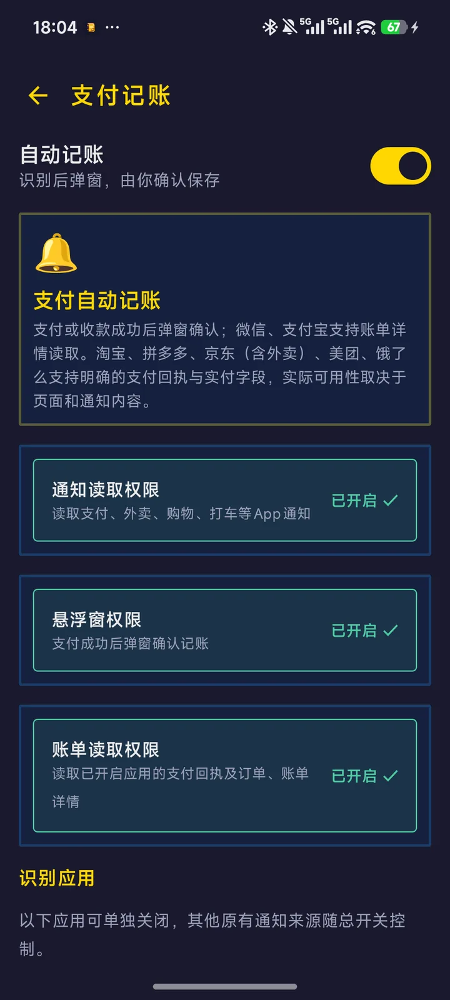

# 像素记账 · PixelMoney

> 付完款的那一刻，账单页面自己弹出来问你要不要记。

一个 Android 自动记账 App。它想解决的不是"记账能不能更快"，而是**根本不用记得去记账**：微信、支付宝扫码/转账/收款完成后，在支付成功页或账单详情页上直接浮起一张记账卡——金额、商家、时间已经填好，点一下入账，点忽略就当没发生。

数据全在本机：没有账号、没有云同步、不联网（只有你主动点「获取参考汇率」时才访问一次 ECB）。表结构、迁移、备份格式都在仓库里，随时可以自己审计。

<table>
<tr>
<td></td>
<td></td>
<td></td>
<td></td>
</tr>
<tr>
<td align="center">付完款，卡片自己浮上来</td>
<td align="center">首页按日分组、可搜索</td>
<td align="center">手动记一笔 / 汇率换算</td>
<td align="center">趋势 · 占比 · 预算</td>
</tr>
<tr>
<td></td>
<td></td>
<td></td>
<td></td>
</tr>
<tr>
<td align="center">80% / 100% 各提醒一次</td>
<td align="center">删除先进回收站，30 天可恢复</td>
<td align="center">导入导出 · 整库备份 · 每日提醒</td>
<td align="center">权限一眼看清</td>
</tr>
</table>

## 下载

- 最新安装包：[Releases · v4.4.2](https://github.com/nanzhe-qwq/PixelMoney/releases/latest) —— 3.4 MB，Android 8.0（API 26）以上
- 想自己编译：见下面的[构建](#构建)

装好后先到「我的 → 支付记账」把两个权限打开：**账单读取**（无障碍）和**后台弹出界面**。后者在澎湃 OS / MIUI 里是独立开关，只开「显示悬浮窗」是不会弹窗的——这是踩过最多次的坑。

## 功能

**自动记账**

- 微信、支付宝：支付成功页、账单详情、收款到账都能识别；页面给出交易时间时按原时间入账，不会把三个月前的账单记成今天。
- 淘宝、拼多多、京东（含京东外卖）、美团、饿了么：只在页面同时出现**明确的完成状态**和**实付金额**时才弹，待付款、物流、优惠提醒一律不算交易。
- 弹窗排队：连着付两笔不会互相覆盖；正在填备注时来新交易只排队、不动你手里的输入框。
- 保存失败不清空表单，改了就能重试；数据库确认写入成功后才关窗。
- 总开关 + 按应用单独开关，想关哪个关哪个。

**记账本身**

- 19 个支出分类、8 个收入分类，带 emoji；多账本（日常开销 / 旅行基金 / 学习投资 …）。
- 首页按日分组、当天小计、关键词搜索、收支筛选、月份切换。
- 汇率换算：11 种货币，可手填银行实际汇率，也可拉 ECB 参考汇率（按日期）。
- 周期记账：房租、会员费这类固定支出，由 AlarmManager 后台补记，最多补 62 天内 12 笔，不会开机后一次灌几十条。

**看账**

- 近 6 个月支出趋势柱状图（跨年正确，当前月高亮）。
- 分类占比环形图（Canvas 手绘，不引第三方图表库）。
- 月度预算：按「分」比较，到 80% 提醒一次、超支再提醒一次，同一个月不重复骚扰。

**数据进出**

- 账单导入：微信 / 支付宝导出的 CSV、XLSX 直接预览，逐笔勾选、逐笔改分类，可选目标账本，重复导入靠交易单号去重。
- 账单导出 CSV（UTF-8 BOM，Excel 不乱码）。
- 整库备份 JSON：账本、账单、回收站、预算、周期规则、导入去重键一次打包，恢复前完整校验、单事务替换。
- 回收站：删除是软删除，30 天内可恢复，删完还会浮一条 4 秒的「撤销」。

## 技术要点

| | |
| --- | --- |
| 语言 / UI | Kotlin + Jetpack Compose（Material 3），像素风自定义配色与组件 |
| 存储 | Room（当前 schema v8，六张表，全部迁移手写且不提供"升级失败就清库"的兜底） |
| 自动记账 | `AccessibilityService` 读页面文本树 → 规则解析（`ScreenPaymentParser`）→ 透明 `Activity`（`PaymentPopupActivity`）承载确认卡 |
| 为什么用透明 Activity 而不是悬浮窗 | 澎湃 OS / MIUI 在支付 App 前台会把 `TYPE_APPLICATION_OVERLAY` 窗口标成 `mAppOpVisibility=false`——窗口建出来了，但你看不见。换成独立 task 的透明 Activity 才能在支付页上直接显示 |
| 金额 | 一律折成整数"分"（`util/Money`）再比较，不拿浮点判阈值 |
| 序列化 | 备份格式自带手写 JSON 解析器（`util/MiniJson`），不引第三方库，也方便在 JVM 单测里跑 |
| 测试 | 132 项单元测试（JVM）+ 29 项真机 instrumentation 测试（设备：小米 15 Ultra / 澎湃 OS 4） |

## 构建

需要 JDK 17、Android SDK（compileSdk 34）、Gradle wrapper 自带。

```bash
git clone https://github.com/nanzhe-qwq/PixelMoney.git
cd PixelMoney
echo "sdk.dir=/path/to/Android/Sdk" > local.properties   # Windows 写成 D:/Android/Sdk
./gradlew :app:assembleDebug
./gradlew :app:testDebugUnitTest
```

Windows 上如果仓库路径含中文，JUnit 会因为类加载拿不到路径而整批失败。实测可行的办法是 `subst P: "<仓库路径>"` 后从 `P:\` 里构建（`Set-Location P:\; .\gradlew.bat ...`）；构建时加 `--no-parallel` 可避开 KSP 偶发的 `cleanFilenames` 未初始化报错。

仓库里不含 keystore、`local.properties`、`artifacts/` 与构建产物；`promo/` 是宣传片的 HyperFrames 工程，其中的字体是系统字体，已从版本库排除。

## 已知边界

这个 App 是在真机上一点点试出来的，边界也写在明面上：

- **识别靠页面文案**。微信/支付宝/淘宝等平台一改版，规则就可能失效——这是这类方案的固有成本，不是配置能解决的。
- 购物和外卖目前只用样本页验证过，没有逐一走完各平台真实支付全流程。
- 收款、退款、红包、转账等场景覆盖不全，还没法保证每种交易都实时弹窗。
- 澎湃 OS 除了「显示悬浮窗」，还要单独开「后台弹出界面」；两者是不同开关，只开一个不会有弹窗。
- 不同渠道对同一笔交易没有统一交易号，为了避免误删真实账单，跨来源不做金额猜重。
- 只在小米 15 Ultra（澎湃 OS 4）上做过真机验证，其他 ROM 未测。

## 相关

- 开发记录（那些踩过的坑是怎么填的）：<https://qwqovoppp.top/blog/pixel-money-automatic-bookkeeping/>
- 更新记录：见 [docs/CHANGELOG.md](docs/CHANGELOG.md)（4.0 → 4.4.2 逐版说明）

## License

[MIT](LICENSE)
